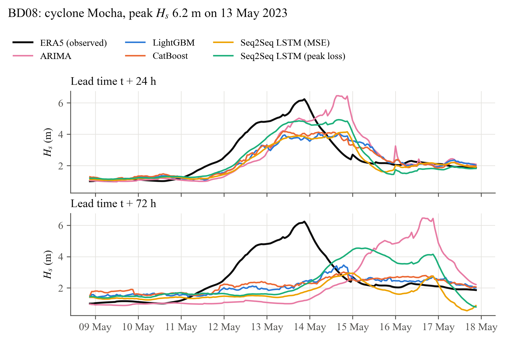

# Multi-Step Significant Wave Height Forecasting in the Bay of Bengal

**Hybrid machine-learning and deep-learning frameworks, 6 to 72 hours ahead**

M.Tech Dual Degree thesis, Department of Ocean Engineering and Naval Architecture, IIT Kharagpur (2026).
Vishesh Bhagwandas Agarwal (22NA30045), supervised by Professor Swapnadip De Chowdhury.

📄 [Thesis report (.docx)](report/Thesis_Report_BoB_SWH_Forecasting.docx) · 📊 [Defence slides (.pptx)](presentation/Thesis_Presentation_BoB_SWH_Forecasting.pptx)

---

## Overview

Tropical cyclones in the Bay of Bengal can raise the significant wave height (Hs) from 1–2 m to more than 10 m within a
day. This project builds data-driven point forecasts of Hs at **6, 12, 24, 48 and 72 h** at the positions of three INCOIS
OMNI moored buoys (BD08, BD10, BD11), as a fast alternative to numerical wave models.

- **Data:** ten years (2015–2024) of hourly ECMWF ERA5 reanalysis at each buoy site, aligned with a KD-tree on the sphere.
- **Physics-based features:** wind stress with a saturating drag coefficient, pressure tendency and anomaly, air–sea
  temperature difference, sine/cosine-encoded directions, wave steepness.
- **Models:** persistence, climatology and ARIMA baselines; Direct Multi-Step **LightGBM** and **CatBoost** tuned with
  Optuna; an encoder–decoder **Seq2Seq Bi-LSTM with attention**, trained with the MSE and with a **peak-weighted loss**
  that penalises under-predicting extreme seas.
- **No look-ahead:** every sample's inputs and all of its targets lie inside one chronological block
  (fit 2015–2019, early stopping 2020, validation 2021–2022, test 2023–2024). Automated tests enforce this.

## Results

Test-period (2023–2024) RMSE in metres, mean of the three sites, every model scored on the same 17,400 forecast origins
per site. The target is ERA5 Hs at the buoy positions.

| Model | 6 h | 12 h | 24 h | 48 h | 72 h |
|---|---|---|---|---|---|
| Persistence | 0.126 | 0.202 | 0.301 | 0.457 | 0.544 |
| Climatology | 0.462 | 0.462 | 0.462 | 0.462 | 0.462 |
| ARIMA | 0.116 | 0.195 | 0.292 | 0.453 | 0.546 |
| **LightGBM** | **0.106** | **0.169** | 0.250 | **0.359** | **0.419** |
| **CatBoost** | 0.108 | **0.169** | **0.247** | 0.367 | 0.420 |
| Seq2Seq LSTM (MSE) | 0.120 | 0.185 | 0.261 | 0.367 | 0.426 |
| Seq2Seq LSTM (peak loss) | 0.157 | 0.220 | 0.299 | 0.419 | 0.502 |

- The best models cut the persistence error by **18% at 24 h** and **23% at 72 h**, and the ARIMA error by 15% and 23%.
- The peak-weighted loss lowers the share of under-predicted extreme seas (above the training 95th percentile) at 24 h
  from **72% to 55%**, and gives the lowest RMSE of all models on extreme seas, at a 14% cost in overall RMSE.
- Inside cyclone windows the errors roughly double; three days ahead no model foresees a cyclone peak from local inputs.

Full results, significance tests and discussion are in Chapter 5 of the report.

<p align="center"></p>

## Repository layout

```
bobswh/          Python package (one module per pipeline step)
  config.py        paths, sites, splits, QC limits, physical constants
  era5.py          ERA5 download (gridded and time-series) and point extraction
  buoy.py          INCOIS OMNI CSV/TXT reader
  alignment.py     nearest valid grid node on the sphere (KD-tree, haversine)
  preprocess.py    range checks, spike test, causal gap filling
  features.py      wind stress, encodings, tendencies (strictly causal)
  windowing.py     sliding windows and leakage-free chronological splits
  baselines.py     persistence and climatology
  sarimax.py       ARIMA with all-origin Kalman forecasts
  trees.py         Direct Multi-Step LightGBM / CatBoost / XGBoost
  tuning.py        Optuna search on the pooled multi-horizon RMSE
  seq2seq.py       Seq2Seq Bi-LSTM with attention and the peak-weighted loss
  evaluation.py    common-sample metrics, skill, Diebold–Mariano tests, cyclone windows
  plots.py         thesis figures
scripts/         command-line entry points for each phase
tests/           44 automated tests (pytest)
docs/            methods notes per phase
figures/         all figures (PNG, 300 dpi)
results/         metrics and tables (CSV/JSON) for phases 3–5
report/          thesis report (.docx) and its generator (report/src)
presentation/    defence slides (.pptx) and their generator (presentation/src)
```

## Reproducing the results

```bash
python3 -m venv --system-site-packages .venv && .venv/bin/pip install -r requirements.txt
.venv/bin/python -m pytest -q                                      # 44 tests, about 7 min

.venv/bin/python scripts/download_era5_timeseries.py               # ERA5, 3 CDS requests (needs ~/.cdsapirc)
.venv/bin/python scripts/build_features.py --era5-only             # Phases 1–2
PHASE=3 bash scripts/run_era5_only.sh                              # baselines and tuned trees
PHASE=4 bash scripts/run_era5_only.sh                              # Seq2Seq LSTMs
.venv/bin/python scripts/run_phase5.py                             # evaluation tables and figures

(cd report/src && ../../.venv/bin/python make_figs.py && ../../.venv/bin/python paginate.py ../Thesis_Report_BoB_SWH_Forecasting.docx)
(cd presentation/src && ../../.venv/bin/python build_deck.py ../Thesis_Presentation_BoB_SWH_Forecasting.pptx ../previews)
```

ERA5 data needs a free [Copernicus CDS](https://cds.climate.copernicus.eu) account with the ERA5 licence accepted. The
downloaded data (~400 MB), feature tables and trained models are not stored in this repository; the commands above
recreate them. `report/src/paginate.py` lays the report out with Apple Pages (macOS) to fill in the page numbers of the
lists of figures and tables; `build.py` alone builds the report without them.

## Data and credits

- **ERA5:** Hersbach et al. (2020), *Q. J. R. Meteorol. Soc.* 146, 1999–2049; ECMWF / Copernicus Climate Change Service,
  CC-BY-4.0.
- **Buoys:** INCOIS Ocean Moored buoy Network for the northern Indian Ocean (OMNI). The buoy reader and quality control
  are implemented and tested; the results above use ERA5 Hs at the buoy positions as the target, because the buoy
  records were not yet available.
